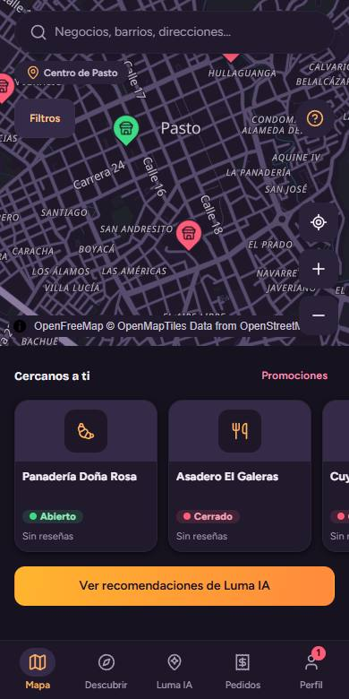
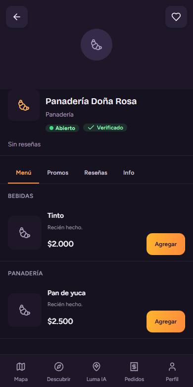
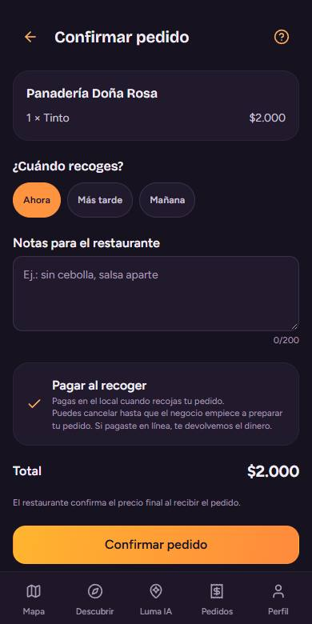
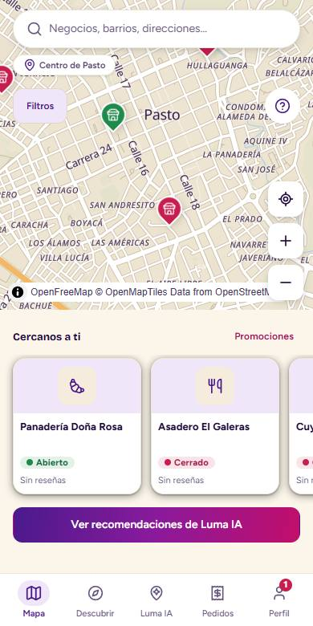
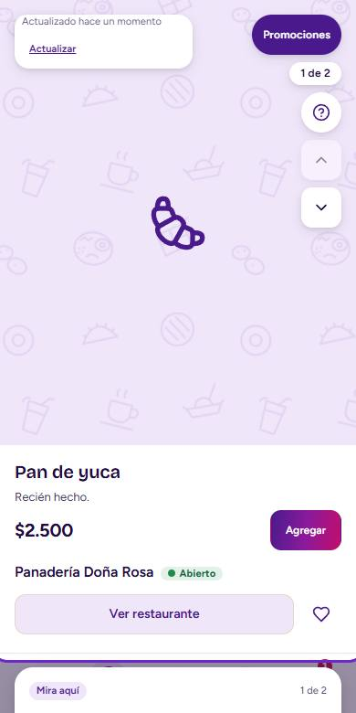
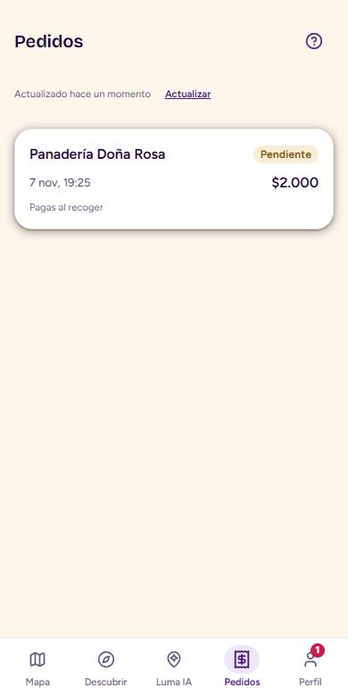
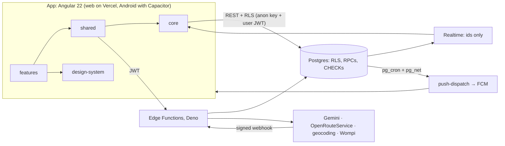

# Luma

Mobile-first app to discover local restaurants and shops in Pasto (Nariño, Colombia) and order
for pick-up.

- **Customers**: a map with live open/closed status, a vertical feed, promotions with real
  discounts, Luma IA recommendations, favourites and reviews. They order for pick-up and pay at
  the counter or online (Wompi), follow the order live and get directions.
- **Business owners** ("Luma Negocios"): register and verify the business, then manage menu,
  hours, photos and promotions. They take orders in real time, and AI reads a paper menu and
  suggests promotions.
- **Review team** (admin with MFA): approves businesses and handles reports, contacts, payments
  and refunds.

Spanish UI by default, English as second language. It ships as a web app (Vercel) and an
Android app (Capacitor).

| Ciruela sobria (dark, default) | | | Crema clara (light) | | |
| --- | --- | --- | --- | --- | --- |
|  |  |  |  |  |  |

## Architecture



- **One-way layers:** dependencies flow `features → shared → core`, and no feature imports another.
  Each feature is a lazy route. Lint enforces this.
- **Server-side security:** RLS on every table, prices computed in Postgres and Zod at every
  boundary. The app only holds the public (anon) key; provider keys live in Edge Function secrets.
- **Payments:** Wompi's hosted checkout handles the card, PSE and Nequi data, so Luma never sees
  them. Only the signed webhook (or the reconciliation) marks an order as paid.
- **Live updates:** they reach the app through Realtime and Android push. A 30 s poll takes over
  when the channel drops.

More: [docs/ARCHITECTURE.md](docs/ARCHITECTURE.md), [docs/DECISIONS.md](docs/DECISIONS.md),
[docs/adr/](docs/adr/).

| Area | Tech |
| --- | --- |
| Frontend | Angular 22 (standalone, Signals, `@if/@for`, OnPush, View Transitions), Transloco, Zod |
| Styles | Tailwind CSS v4 on design tokens (`src/styles/`), two themes |
| Backend | Supabase: Postgres + RLS, Auth (6-digit codes), Storage, Realtime, Edge Functions (Deno), pg_cron |
| Map and routes | MapLibre GL with OpenFreeMap tiles; OpenRouteService |
| AI | Gemini through a swappable LLM gateway; rules when the AI is off or fails |
| Payments | Wompi hosted checkout (sandbox) |
| Mobile | Capacitor 8 (Android), Firebase Cloud Messaging |
| Tests | Vitest, `node:test`, Deno test, SQL suites on Postgres, Playwright e2e |

## Run it

Needs Node.js 24 and npm 11. You also need a Supabase project with the migrations applied (see
[Database](#database)).

```sh
npm ci
cp src/environments/environment.example.ts src/environments/environment.ts
# put your Supabase URL and anon (public) key in environment.ts; it is gitignored
npm start                      # http://localhost:4200
```

| Command | What it does |
| --- | --- |
| `npm run build:prod` | The web build Vercel runs. It needs only `SUPABASE_URL` and `SUPABASE_ANON_KEY`; `AI_MODE`, `SUPPORT_WHATSAPP` and `LEGAL_CONTACT_EMAIL` are optional. A clean clone builds (CI job `clean-build`). |
| `npm run apk:debug` / `apk:release` | Android APK ([docs/android.md](docs/android.md)) |
| `powershell -File scripts\luma.ps1` | Sets up and verifies the backend (AI, push, payments, routes, WhatsApp, APK). Secrets stay in `%USERPROFILE%\luma-secrets` ([docs/luma-setup.md](docs/luma-setup.md)). |

## Try the payments (Wompi sandbox)

No real money moves.

1. Turn the payments on once ([docs/payments-setup.md](docs/payments-setup.md)): option 3 of
   `scripts\luma.ps1`, then `payments_enabled = 1`.
2. As a customer, open a business, add a product, choose **Pagar en línea** and confirm.
3. On Wompi's page, use the official sandbox data:

   | Method | Approved | Declined |
   | --- | --- | --- |
   | Card (any future date, any 3-digit CVC) | `4242 4242 4242 4242` | `4111 1111 1111 1111` |
   | Nequi | `3991111111` | `3992222222` |
   | PSE | "Banco que aprueba" | "Banco que rechaza" |

4. Luma comes back to the order: "Pagado en línea" and a notice when approved, "Reintentar
   pago" when declined. The business sees the order only once it is paid.
5. As admin, **Operaciones** lists the payments with problems, has **Conciliar ahora** and
   handles refunds.

`npm run wompi:replay -- <transaction id>` replays a forged, a repeated and a late event against
the webhook. Only the genuine one counts.

## Tests

| Command | Covers |
| --- | --- |
| `npm test -- --watch=false` | Unit and component tests (Vitest), about 1,050 |
| `npm run test:scripts` | Build, setup and check scripts |
| `npm run test:e2e` | Sign-up, pick-up order, owner panel and sandbox payment in a real browser, against simulated services |
| `supabase/tests/local/run.sh` | SQL suites: RLS, permissions, orders, payments and cron, on a throwaway Postgres |
| `deno test` per function | Edge Functions ([.github/workflows/ci.yml](.github/workflows/ci.yml)) |
| `npm run check:contrast`, `check:tokens`, `check:hardcoded-urls`, `check:interactive`, `check:buttons` | AA contrast, design tokens, URLs in config, accessible controls |
| `node scripts/secret-scan.mjs`, `npm audit --omit=dev` | No secrets in the repository, no vulnerable runtime dependency |
| `npm run perf` | Frame rate with the CPU slowed down 4 times ([docs/optimization-report.md](docs/optimization-report.md)) |

CI runs all of them on every push, plus CodeQL and a production build from a clean clone.

## Database

Apply `supabase/migrations/` in filename order. [docs/migrations.md](docs/migrations.md) lists
every file and whether it is applied. `supabase/seed.sql` and `supabase/seed_menu_items.sql`
load five test businesses in Pasto. Who may do what:
[docs/roles.md](docs/roles.md).

## Project layout

```
src/app/core/           session, Supabase client, realtime, push, config, validation, native bridges
src/app/shared/         repositories and stores shared by features: business, orders, payments, map, cart…
src/app/design-system/  base components (button, card, sheet, tabs, inputs…)
src/app/features/       one lazy route per area: map, feed, ai, checkout, orders, owner, admin, auth…
src/styles/             tokens, the two themes, motion, map
supabase/               migrations, Edge Functions (+ _shared), SQL tests, seeds
scripts/                build, setup (luma.ps1) and check scripts
e2e/                    browser tests and the frame-rate measurement
android/                Capacitor Android project
docs/                   documentation (below)
```

## Documentation

- [docs/demo.md](docs/demo.md): the presentation script, step by step.
- [docs/feature-matrix.md](docs/feature-matrix.md): every feature, its state and its tests.
- [docs/payments.md](docs/payments.md): the payment flow, data, refunds and one or many Wompi accounts.
- [docs/security.md](docs/security.md) · [docs/security-findings.md](docs/security-findings.md) · [docs/threat-model.md](docs/threat-model.md)
- [docs/launch-checklist.md](docs/launch-checklist.md): what is left before real users.
- [docs/legal-notes.md](docs/legal-notes.md): what a lawyer must review.
- [docs/WORKLOG.md](docs/WORKLOG.md): what was done, round by round.
- `CLAUDE.md` and `.kiro/steering/`: the rules of the project (language, layers, tokens, security).
