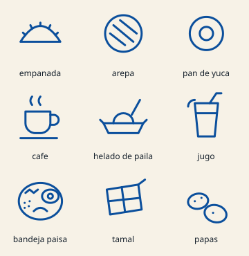

# Food doodles

Original line drawings of food and drinks of Nariño and Colombia, drawn for
Luma (round 8) on a 64 px grid with 2.5 px round lines: empanada, arepa, pan
de yuca, café, helado de paila, jugo, bandeja paisa, tamal and papas. They
take the idea of the references (patterns of food drawings on coloured
backgrounds) without copying any image, character or brand.

## Files

| File | What |
| --- | --- |
| `public/media/doodles/line.svg` | The 260 px repeating tile in black lines: a CSS mask, coloured by tokens |
| `public/media/doodles/color.svg` | The same tile in the brand colours (covers) |
| `docs/brand/doodles.svg` | Every drawing with its name |

They are generated from one list of paths, `docs/brand/doodles-generator.py`
(`python docs/brand/doodles-generator.py` from the repository root); to add a
food, draw it on the same grid and run it again.

## Three looks (`src/styles/doodles.css`)

| Class | Look | Where |
| --- | --- | --- |
| `.doodles` | Light lines on deep blue at night, dark low-contrast lines on cream by day (`--color-doodle-line`) | App entry, sign-in, sign-up, code and password screens |
| `.doodles--faint` | The same, quieter (`--color-doodle-faint`) | Behind every customer and owner screen, the welcome |
| `.doodles--on-brand` | Light lines on the brand gradient (`--color-doodle-on-brand`) | Owner portada, welcome illustration, feed posts without a photo |
| `.doodles--color` | Multicolour tile at 35 % | Covers |
| `.doodles--veil` | Adds a canvas veil | Wherever text sits on top (always with backgrounds) |

The tile drifts one tile diagonally in 120 s, linear and endless; with
reduced motion it stands still. Doodles are decoration only: never text,
never information, `aria-hidden`.
