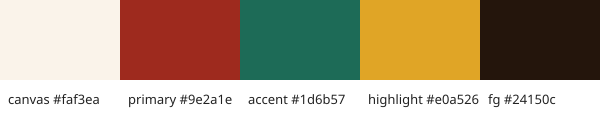
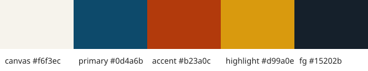
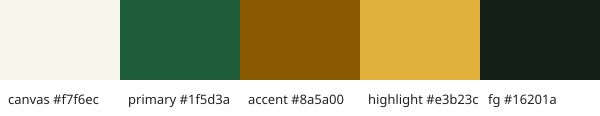

> **Decided (round 13):** two themes only: Ciruela sobria (`ciruela`, dark, main) and Crema clara (`crema`, light). What follows is history. Tokens: `src/styles/tokens.css` and `src/styles/themes/crema.css`. The brand gradient (`.brand-gradient`) goes only on main actions, AI and promotions. The map takes its colours from `--color-map-*` (`MapTheme`).

# Palette: three directions

Round 2 drops the generic indigo and violet with blue-violet gradients. The
starting point is local food from Pasto and Nariño: the barniz de Pasto
(mopa-mopa lacquer on wood), ají, maize, cilantro and the Andean sky. The
case study still asks for blue as the main identity colour
(`.kiro/steering/product.md`), so one direction keeps a blue that is not
indigo.

Every ratio below is WCAG 2.1, computed with `scripts/brand-contrast.mjs`
(`contrast()`), not estimated. AA needs 4.5:1 for normal text and 3:1 for
large text and UI parts.

## A. Barniz de Pasto

Lacquer red-brown `#9e2a1e`, lacquer green `#1d6b57`, maize gold `#e0a526`,
on warm paper `#faf3ea`.

| Pair | Ratio |
| --- | --- |
| White on primary | 7.49 |
| Primary on canvas | 6.80 |
| Accent on white / white on accent | 6.38 |
| Text `#24150c` on canvas | 16.06 |
| Maize on white | 2.19 (decoration only, never text) |

Strong and local, but the brand red sits too close to "danger" and to the
"closed" status: semantic colours would have to move away from red.

## B. Cielo andino y ají (chosen)

Andean sky `#0d4a6b` (a petrol blue, hue about 205°, far from indigo at
about 235°), ají `#b23a0c`, maize `#d99a0e`, on corn-husk paper `#f6f3ec`.

| Pair | Ratio |
| --- | --- |
| White on primary | 9.51 |
| Primary on canvas | 8.58 |
| Accent on white / white on accent | 5.99 |
| Text `#15202b` on canvas | 14.88 |
| Maize on white | 2.45 (stars and decoration only, never text) |

## C. Cilantro y maíz

Cilantro `#1f5d3a`, maize brown `#8a5a00`, maize gold `#e3b23c`, on
`#f7f6ec`.

| Pair | Ratio |
| --- | --- |
| White on primary | 7.82 |
| Primary on canvas | 7.21 |
| Accent on white / white on accent | 5.93 |
| Text `#16201a` on canvas | 15.41 |
| Maize gold on white | 1.96 (decoration only) |

Fresh and appetising, but the brand green collides with "success" and the
"open" status, the most frequent signal on the map.

## Choice: B, "Cielo andino y ají"

- Keeps the case study's blue identity without the generic indigo/violet.
- Ají is warm and appetising for highlights and Luma IA, and it is far from
  every semantic colour.
- Semantic colours stay distinct from the brand: success cilantro
  `#2e7d32`, warning maize `#d99a0e`, danger crimson `#c42839`, info Andean
  teal `#0e7c86` (never the brand blue).
- The best margins: 9.51:1 for white on the primary colour.

## Round 8: more life, same direction

The chosen direction keeps its three colours, now more saturated:

| Colour | Before | Round 8 | Use |
| --- | --- | --- | --- |
| Azul andino profundo | `#0d4a6b` | `#0b4f9c` | primary, brand text, buttons |
| Ají | `#b23a0c` | `#c93a0e` (text `#b8340c`) | accent, highlights, Luma IA |
| Amarillo sol | `#d99a0e` | `#f5b700` | ratings, the strong warning button (dark text), doodles — never text on white |
| Papel crema | `#f6f3ec` | `#f7f2e7` | canvas |

| Pair (WCAG 2.1, `scripts/brand-contrast.mjs`) | Ratio |
| --- | --- |
| White on primary | 8.04 |
| Primary on canvas | 7.20 |
| White on ají | 5.13 |
| Ají text on white | 5.94 |
| Text `#15202b` on canvas | 14.77 |
| Sun yellow on white | 1.80 (decoration only) |
| Night: text `#eef3fa` on canvas `#0b1628` | 16.24 |
| Night: white on primary `#2a66c4` | 5.53 |

Night is now a deep Andean blue (canvas `#0b1628`, surface `#13233d`)
instead of a grey blue. Buttons carry the saturated colours: the primary
blue, ají for accent actions, sun yellow (dark text) for the strong warning.
The food doodles (docs/brand/doodles.md) bring the rest of the life.

## Themes (same token structure, `src/styles/`)

| Theme | Id | Kind | Primary | Accent |
| --- | --- | --- | --- | --- |
| Cielo andino | `sky` (default, `tokens.css`) | light | `#0b4f9c` | ají `#c93a0e` |
| Noche | `night` | dark | `#2a66c4` (text `#8ec2ff`) on deep blue | ají `#ff8a5c` |
| Barniz | `lacquer` | light accent | cinnamon wood `#7a3b16` | lacquer green `#17665a` |
| Maíz | `maize` | light accent | maize brown `#7a5000` | Andean blue `#0d5f86` |

`npm run check:contrast` checks 28 text and UI pairs in each theme (text,
muted and subtle text on canvas and surface, brand and accent text, every
filled button, every feedback and status badge, navigation, focus ring and
strong borders) and fails under AA. All four themes pass.

No glass cards or diffuse coloured glows: surfaces are flat paper and
white, and shadows are short and neutral. The brand gradient (primary to
ají) is kept for covers and the Luma IA entry, with light doodles over it.
